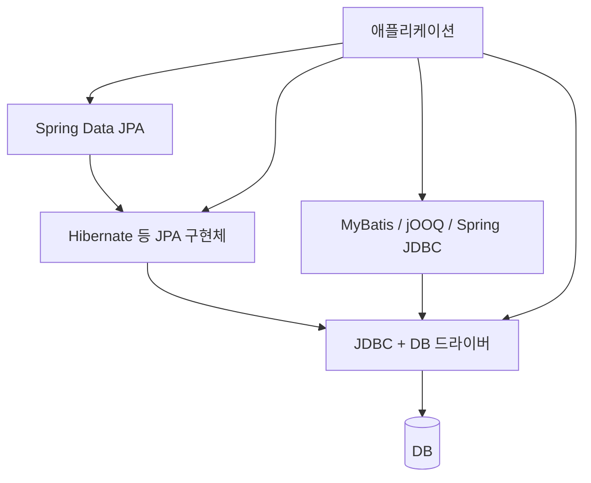

# 00-02. Java 데이터 접근 기술 한눈에 보기

## 기술별 역할

| 기술 | 역할 |
|---|---|
| JDBC | Java에서 DB 연결과 SQL 실행을 위한 표준 API |
| JDBC 드라이버 | JDBC 호출을 DB별 통신으로 구현 |
| Spring JDBC | JDBC 실행·바인딩·자원 관리의 반복 코드 처리 |
| MyBatis | 직접 작성한 SQL을 Mapper 메서드와 연결하고 결과 매핑 |
| jOOQ | Java DSL로 SQL 작성, 실행과 결과 매핑 지원 |
| JPA | 객체·관계 매핑과 영속성 관리의 표준 명세 |
| Hibernate / EclipseLink | JPA 구현체 |
| Spring Data JPA | JPA 기반 Repository 구현 자동화 |
| Spring Data JDBC | Aggregate 중심 매핑과 Repository 구현 지원 |
| R2DBC | JDBC와 별개인 리액티브 DB 접근 경로 |

## 대표적인 실행 경로

JPA는 명세이고 Hibernate는 구현체다. Spring Data JPA는 그 위에서 Repository를 제공한다. 같은 역할의 대안이라도 코드·설정 변경 없이 교체할 수 있다는 뜻은 아니다.

## simple-jorm의 위치

현재는 JDBC 실행·자동 행 매핑, Mapper CRUD, Service 트랜잭션 프록시·REQUIRED, 엔티티 메타데이터·INSERT까지 구현했다. ID 조회까지 구현했고 영속성 컨텍스트는 아직 없다.

| 우리 학습 단계 | 가까운 기술·기능 | 상태 |
|---|---|---|
| 01 SQL 실행·RowMapper | Spring JDBC의 템플릿·결과 매핑 | 완료 |
| 02 SQL 어노테이션·Mapper 프록시 | MyBatis의 SQL Mapper | 기본 CRUD 완료 |
| 03 Connection 공유·Service 프록시·REQUIRED | Spring의 트랜잭션 관리. ORM과 별도 계층 | 완료 |
| 04 엔티티 매핑·SQL 생성 | Hibernate 등 ORM의 매핑 분석·INSERT 생성 | 메타데이터·persist·find 완료 |
| 05 객체 동일성·변경 감지·flush | JPA 영속성 컨텍스트와 Hibernate 상태 관리 | 미구현 |

이 대응은 역할과 학습 개념의 비교다. simple-jorm이 MyBatis나 JPA 전체를 구현했다는 뜻은 아니다. **JPA는 표준이고 Hibernate는 구현체**이며, Spring Data JPA의 Repository는 그 위의 별도 계층이다.

우리 EntityManager는 INSERT를 즉시 실행하고 구조 정보만 캐시한다. JPA의 관리 상태·영속성 컨텍스트·flush는 없다. 동일한 클래스·메서드 이름만으로 실행 시점과 스레드 사용 규칙까지 같다고 보면 안 된다.

[단계별 코드·실제 기술 대응과 차이](../reference/03-learning-stage-mapping.md)에 공식 자료와 상세 비교를 정리했다. [진행 상황](01-progress.md)과 [엔티티 매핑·INSERT](../04-entity-crud/01-metadata-and-insert.md)에서 현재 구현 범위를 확인할 수 있다.

커넥션 풀은 연결 재사용, 트랜잭션 매니저는 commit·rollback 범위를 담당한다. 둘 다 ORM이나 SQL Mapper와 역할이 다르다.

## 상세 설명

[Java ORM과 데이터 접근 생태계 전체 문서](../reference/01-java-orm-ecosystem.md)에 전체 계층도, 대안별 교체 범위, SQL·객체 관리 비교, 기술 조합 시 주의점과 의존성 설명을 보존한다.

## 공식 참고 자료

- [JDBC API](https://docs.oracle.com/en/java/javase/21/docs/api/java.sql/module-summary.html)
- [Jakarta Persistence](https://jakarta.ee/specifications/persistence/)
- [Spring Data JPA](https://docs.spring.io/spring-data/jpa/reference/)
- [MyBatis](https://mybatis.org/mybatis-3/index.html)
- [jOOQ](https://www.jooq.org/doc/latest/manual/sql-building/)
