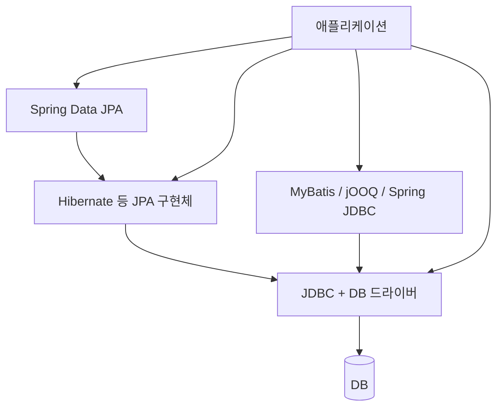

# 00-02. Java 데이터 접근 기술 한눈에 보기

## 기술별 역할

| 기술 | 역할 |
|---|---|
| JDBC | Java에서 DB 연결과 SQL 실행을 위한 표준 API |
| JDBC 드라이버 | JDBC 호출을 DB별 통신으로 구현 |
| Spring JDBC | JDBC 실행·바인딩·자원 관리의 반복 코드 처리 |
| MyBatis | 직접 작성한 SQL을 Mapper 메서드와 연결하고 결과 매핑 |
| jOOQ | Java DSL로 SQL 작성, 실행과 결과 매핑 지원 |
| JPA | 객체·관계 매핑과 영속성 관리의 표준 명세 |
| Hibernate / EclipseLink | JPA 구현체 |
| Spring Data JPA | JPA 기반 Repository 구현 자동화 |
| Spring Data JDBC | Aggregate 중심 매핑과 Repository 구현 지원 |
| R2DBC | JDBC와 별개인 리액티브 DB 접근 경로 |

## 대표적인 실행 경로



JPA는 명세이고 Hibernate는 구현체다. Spring Data JPA는 그 위에서 Repository를 제공한다. 같은 역할의 대안이라도 코드·설정 변경 없이 교체할 수 있다는 뜻은 아니다.

## simple-jorm의 위치

현재는 JDBC 위에 SQL 실행과 결과 매핑을 추상화하고, Mapper 메서드 호출을 연결하는 단계다. JPA 수준의 엔티티 상태 관리는 아직 없다.

```text
JDBC 실행·행 매핑 → Mapper 프록시 → 트랜잭션 → 엔티티 CRUD → 영속성 컨텍스트
      완료           현재 단계          이후 학습
```

커넥션 풀은 연결 재사용, 트랜잭션 매니저는 commit·rollback 범위를 담당한다. 둘 다 ORM이나 SQL Mapper와 역할이 다르다.

현재 상태는 [진행 상황](01-progress.md), 구체적인 구현 설명은 [문서 목차](../README.md)를 참고한다.

## 상세 설명

[Java ORM과 데이터 접근 생태계 전체 문서](../reference/01-java-orm-ecosystem.md)에 전체 계층도, 대안별 교체 범위, SQL·객체 관리 비교, 기술 조합 시 주의점과 의존성 설명을 보존한다.

## 공식 참고 자료

- [JDBC API](https://docs.oracle.com/en/java/javase/21/docs/api/java.sql/module-summary.html)
- [Jakarta Persistence](https://jakarta.ee/specifications/persistence/)
- [Spring Data JPA](https://docs.spring.io/spring-data/jpa/reference/)
- [MyBatis](https://mybatis.org/mybatis-3/index.html)
- [jOOQ](https://www.jooq.org/doc/latest/manual/sql-building/)
