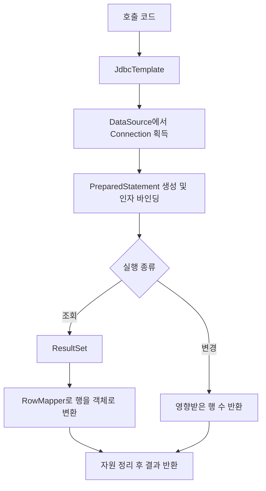

# 01-01. JDBC 실행과 결과 매핑

이 단계는 Spring JDBC의 JdbcTemplate·RowMapper처럼 SQL 실행과 결과 매핑을 분리하는 역할을 학습한다. 엔티티 상태를 관리하는 ORM 계층은 아직 이 단계의 범위가 아니다. [단계별 실제 기술 대응과 차이](../reference/03-learning-stage-mapping.md)를 함께 참고한다.

## 이 단계의 목적

SQL 실행, 파라미터 바인딩, 자원 정리와 객체 매핑을 분리한다. 이 코드가 다음 Mapper 단계에서 실제 DB 작업을 담당한다.

## 구현과 역할

| 코드 | 역할 |
|---|---|
| [JdbcTemplate](../../src/main/java/com/jorm/jdbc/JdbcTemplate.java) | 연결 획득, SQL 실행, 인자 바인딩과 자원 정리 |
| [RowMapper](../../src/main/java/com/jorm/jdbc/RowMapper.java) | ResultSet 한 행을 객체로 변환하는 콜백 |
| [BeanPropertyRowMapper](../../src/main/java/com/jorm/jdbc/BeanPropertyRowMapper.java) | 기본 생성자, public setter 우선·필드 fallback 자동 매핑 |

`JdbcTemplate`은 실행을 담당하고 `RowMapper`는 한 행의 변환을 담당한다. 자동 매퍼는 컬럼 라벨을 JavaBean 프로퍼티와 대소문자 구분 없이 연결한다. `first_name`은 `setFirstName(...)` 또는 `firstName` 필드에 연결된다. public setter가 있으면 먼저 사용하고, 없으면 기존처럼 대상 클래스에 선언된 쓰기 가능한 필드에 대입한다. 조회별 `prepare()`가 컬럼 순서의 매핑을 준비하여 여러 행에서 재사용한다.

## 자동 매핑의 작은 계약

- 인자 없는 생성자가 필요하며, 조회하지 않은 프로퍼티는 초기값을 유지한다.
- 상속된 public JavaBean setter도 사용한다. 직접 필드 fallback은 대상 클래스의 선언 필드만 지원하고 static·final 필드는 제외한다.
- 서로 다른 프로퍼티의 이름·snake_case 별칭이 대소문자 무시 비교에서 겹치면 생성 시 `IllegalArgumentException`으로 거부한다. 예를 들어 `setURL`과 `setUrl`은 모호하다. 같은 프로퍼티의 필드와 setter는 setter를 우선한다.
- 숫자 타입 사이의 변환은 값이 정확히 보존되는 경우에만 허용한다. 정수 범위 초과·소수 절삭·부동소수점 정밀도 손실·NaN·Infinity 변환을 거부한다. 문자열의 숫자 해석은 제공하지 않는다.
- 숫자 `0`/`1`을 boolean으로, 한 글자 문자열을 char로 변환한다. JDBC `Date`·`Time`·`Timestamp`는 각각 `LocalDate`·`LocalTime`·`LocalDateTime`으로 변환한다. 나머지는 원래 타입이 대입 가능한 경우만 허용한다.
- SQL NULL은 참조 타입에 null로 전달하며 primitive에는 `SQLException`을 던진다. setter가 던진 원인은 `SQLException.getCause()`에 보존한다.
- 대응 프로퍼티가 없는 컬럼과 지원하지 않는 변환은 `SQLException`으로 실패한다. 엔티티 단계의 `@Column`은 여기서 해석하지 않는다.

이 범위는 [Spring 6.2.12 BeanPropertyRowMapper 공식 문서](https://docs.spring.io/spring-framework/docs/6.2.12/javadoc-api/org/springframework/jdbc/core/BeanPropertyRowMapper.html)의 setter·underscore 매핑과 기본 타입 지원을 작은 구현으로 학습하기 위한 것이다. Spring은 `ConversionService`, primitive NULL 기본값 옵션, 전체 프로퍼티 조회 검증 등을 제공하지만 이 구현은 제공하지 않는다. 필드 fallback과 손실 없는 숫자 변환 정책도 자체 계약이며 Spring과 모든 변환 결과가 같다는 뜻은 아니다.

## 현재 반환 규칙

- `queryForObject`: 결과가 없으면 `null`, 하나 이상이면 첫 번째 행만 매핑한다. 여러 행을 오류로 처리하지 않는다.
- `query`: 모든 행을 리스트로 반환하고, 결과가 없으면 빈 리스트를 반환한다.
- `update`: INSERT·UPDATE·DELETE의 영향받은 행 수를 반환한다.
- `?`는 `setObject(i + 1, args[i])`로 순서대로 바인딩한다.
- Connection·Statement·ResultSet은 try-with-resources로 정리한다.

## 테스트와 한계

[JDBC 테스트 폴더](../../src/test/java/com/jorm/jdbc/)에서 H2 실행과 매핑 동작을 확인한다. 현재 각 호출이 Connection을 별도로 획득·반환하므로 여러 SQL 작업을 묶는 트랜잭션은 아직 제공하지 않는다.

Spring과 달리 `SQLException`을 `DataAccessException`으로 번역하지 않는다. Spring의 일반적인 `queryForObject`는 정확히 한 행을 요구하지만 자체 구현의 0행 null·복수행 첫 행 반환 계약은 그대로 유지한다. record 생성자 매핑, 사용자 정의 변환 서비스, LOB·vendor 전용 타입 변환은 범위 밖이다.

리플렉션 매퍼의 지원 범위와 전체 상태는 [진행 상황](../00-overview/01-progress.md), 성능 측정은 [별도 실험](../lab/README.md)에 기록한다.

다음: [02 Mapper 프록시 실행 흐름](../02-mapper/01-proxy-execution.md).
