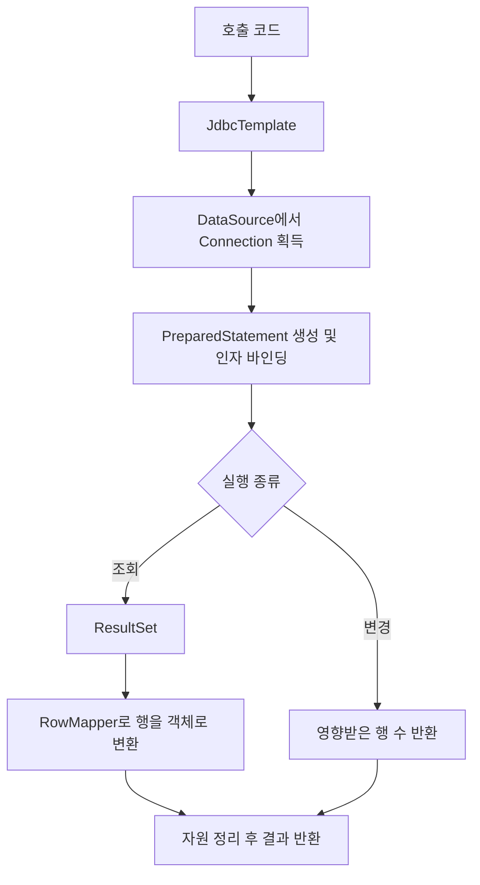

# 01-01. JDBC 실행과 결과 매핑

## 이 단계의 목적

SQL 실행, 파라미터 바인딩, 자원 정리와 객체 매핑을 분리한다. 이 코드가 다음 Mapper 단계에서 실제 DB 작업을 담당한다.

## 구현과 역할

| 코드 | 역할 |
|---|---|
| [JdbcTemplate](../../src/main/java/com/jorm/jdbc/JdbcTemplate.java) | 연결 획득, SQL 실행, 인자 바인딩과 자원 정리 |
| [RowMapper](../../src/main/java/com/jorm/jdbc/RowMapper.java) | ResultSet 한 행을 객체로 변환하는 콜백 |
| [BeanPropertyRowMapper](../../src/main/java/com/jorm/jdbc/BeanPropertyRowMapper.java) | 기본 생성자와 필드를 이용한 자동 매핑 |

`JdbcTemplate`은 실행을 담당하고 `RowMapper`는 한 행의 변환을 담당한다. 자동 매퍼는 컬럼 라벨과 필드명을 대소문자 구분 없이 연결한다.

## 현재 반환 규칙

- `queryForObject`: 결과가 없으면 `null`, 하나 이상이면 첫 번째 행만 매핑한다. 여러 행을 오류로 처리하지 않는다.
- `query`: 모든 행을 리스트로 반환하고, 결과가 없으면 빈 리스트를 반환한다.
- `update`: INSERT·UPDATE·DELETE의 영향받은 행 수를 반환한다.
- `?`는 `setObject(i + 1, args[i])`로 순서대로 바인딩한다.
- Connection·Statement·ResultSet은 try-with-resources로 정리한다.

## 테스트와 한계

[JDBC 테스트 폴더](../../src/test/java/com/jorm/jdbc/)에서 H2 실행과 매핑 동작을 확인한다. 현재 각 호출이 Connection을 별도로 획득·반환하므로 여러 SQL 작업을 묶는 트랜잭션은 아직 제공하지 않는다.

리플렉션 매퍼의 지원 범위와 전체 상태는 [진행 상황](../00-overview/01-progress.md), 성능 측정은 [별도 실험](../lab/README.md)에 기록한다.

다음: [02 Mapper 프록시 실행 흐름](../02-mapper/01-proxy-execution.md).
