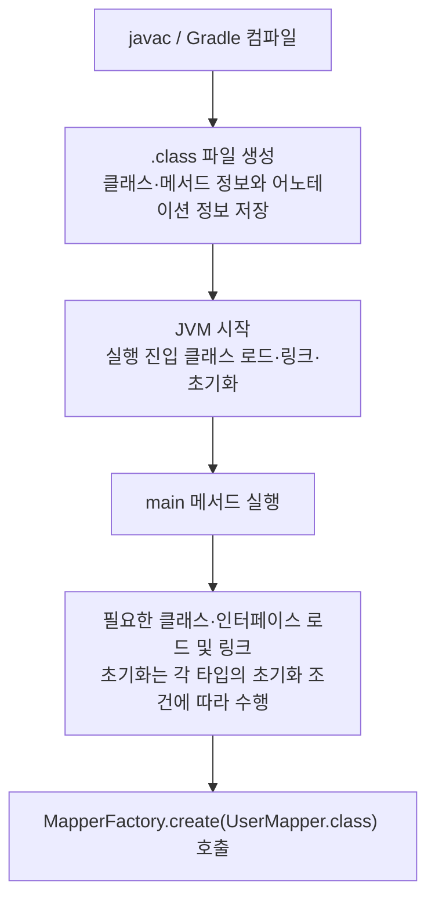
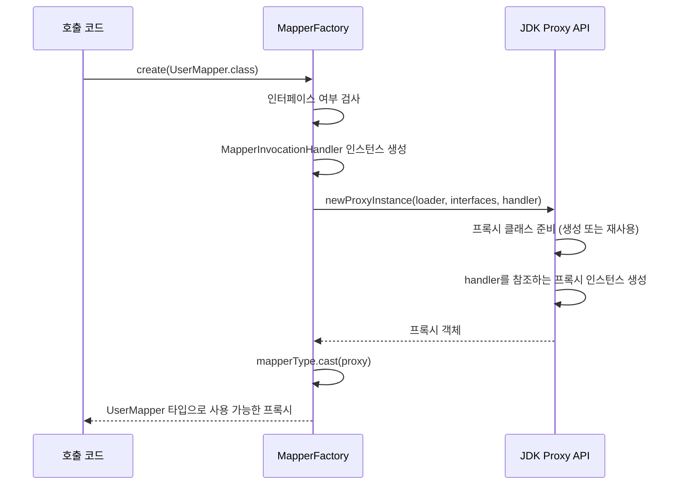
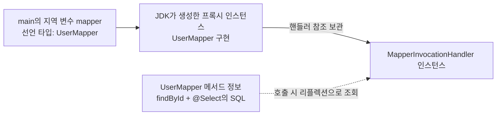
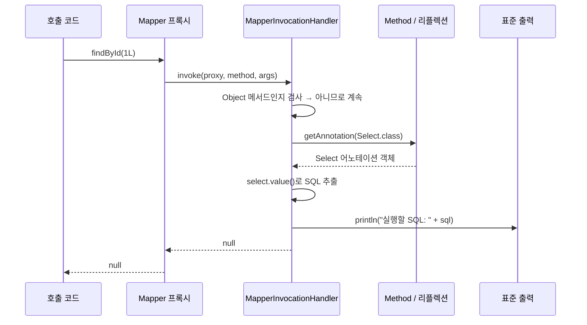
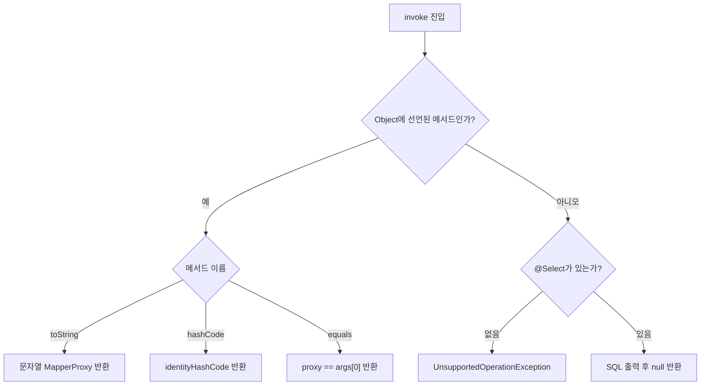
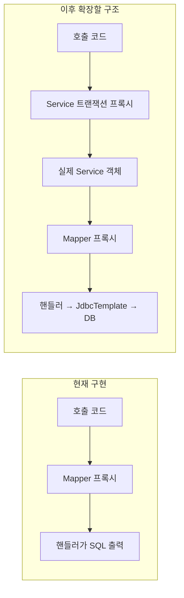

# 02-01. JVM 실행부터 Mapper 프록시 호출까지

작성일: 2026-10-30

> 이 문서는 SQL 출력까지만 구현했던 초기 단계의 실행 과정을 보존한다. 현재는 JDBC 조회와 INSERT·UPDATE·DELETE를 지원한다. 최신 동작과 테스트는 [현재 Mapper 기능](02-tests-and-next-steps.md)을 참고한다.

## 현재 구현 범위

현재 구현은 `Select`, `MapperFactory`, `MapperInvocationHandler` 세 클래스다. Mapper 인터페이스의 프록시를 만들고, 메서드 호출 시 `@Select`의 SQL을 읽어 출력한다. DB 조회와 인자 바인딩은 아직 하지 않으며, SQL 출력 후 `null`을 반환한다.

아래 `UserMapper`와 `main()`은 실행 흐름을 설명하기 위한 예시다. 현재 저장소에 구현된 실행 진입점이나 Mapper는 아니다.

```java
public interface UserMapper {
    @Select("SELECT * FROM users WHERE id = ?")
    Object findById(Long id);
}

public class Main {
    public static void main(String[] args) {
        UserMapper mapper = MapperFactory.create(UserMapper.class);
        Object result = mapper.findById(1L);
        System.out.println(mapper);
    }
}
```

## 1. 컴파일과 JVM 실행



컴파일러는 Java 소스를 JVM이 실행할 `.class` 파일로 변환한다. `@Select`는 `RUNTIME` 정책이므로 실행 중 리플렉션으로 조회할 수 있는 형태로 정보가 남는다. SQL 문자열은 메타데이터로 저장될 뿐, 컴파일이나 JVM 시작만으로 SQL이 실행되지는 않는다.

JVM은 실행에 필요한 타입을 클래스 로더로 로드하고, 링크 과정에서 검증·준비 등을 수행한다. 참조 해석은 JVM 구현에 따라 필요한 시점까지 미뤄질 수 있다. 모든 프로젝트 클래스를 시작과 동시에 로드하고 초기화하는 것은 아니다. 또한 `UserMapper.class`로 Class 객체를 얻는 것 자체는 해당 인터페이스의 초기화를 유발하지 않는다.

`UserMapper.class`는 Mapper 객체가 아니라 **인터페이스 타입을 나타내는 `Class<UserMapper>` 객체**다. 이 시점에는 Mapper 프록시가 아직 없다.

## 2. MapperFactory가 프록시를 생성

실제 코드: [MapperFactory.java](../../src/main/java/com/jorm/mapper/MapperFactory.java)

```java
Object proxy = Proxy.newProxyInstance(
    mapperType.getClassLoader(),
    new Class<?>[]{mapperType},
    new MapperInvocationHandler()
);
return mapperType.cast(proxy);
```



| 전달하는 값 | 역할 |
|---|---|
| `mapperType.getClassLoader()` | 프록시 클래스를 정의할 클래스 로더 |
| `new Class<?>[]{mapperType}` | 프록시가 구현할 인터페이스 목록 |
| `new MapperInvocationHandler()` | 이 프록시의 메서드 호출을 처리할 객체 |

`isInterface()`가 거짓이면 `IllegalArgumentException`이 발생한다. 검사에 통과하면 JDK가 인터페이스를 구현하는 프록시 클래스를 준비한다. 프록시 클래스는 재사용할 수 있지만, 이 팩토리는 호출할 때마다 새 핸들러와 새 프록시 인스턴스를 만든다.

`mapperType.cast(proxy)`는 기존 프록시 객체를 지정 타입으로 변환한다. 여기서 새 객체가 만들어지지는 않는다.

## 3. 생성 후 객체 관계



`UserMapperImpl` 같은 실제 Mapper 구현 객체는 없다. 프록시가 인터페이스의 구현 객체 역할을 하고, 호출을 핸들러에 전달한다. 별도의 핸들러 등록소도 없다. 프록시를 만들 때 넘긴 핸들러를 프록시 객체가 참조한다.

어노테이션이 담당자를 선택하는 것이 아니다. 개발자가 프록시에 핸들러를 연결하고, 핸들러 코드가 `Select.class`를 지정해 해당 어노테이션을 읽는다.

## 4. findById 호출부터 반환까지

실제 코드: [MapperInvocationHandler.java](../../src/main/java/com/jorm/mapper/MapperInvocationHandler.java)



핸들러에 전달되는 정보는 다음과 같다.

| 인자 | `mapper.findById(1L)` 호출 시 의미 |
|---|---|
| `proxy` | 호출을 받은 Mapper 프록시 객체 |
| `method` | 인터페이스의 `findById` 메서드를 나타내는 `Method` 객체 |
| `args` | 인자를 담은 `Object[]`. 이 예시는 `[1L]` |

인자가 없는 메서드는 `args`가 `null`일 수 있다. 현재 구현은 `args`로 SQL의 `?`를 채우지 않는다. 출력되는 SQL은 `SELECT * FROM users WHERE id = ?` 그대로다.

핸들러의 반환값은 프록시를 거쳐 호출자에게 반환된다. 현재는 항상 `null`이므로 예시의 `result`도 `null`이다. 반환 타입을 `int` 같은 기본형으로 선언하면 `null`을 기본형으로 변환하는 과정에서 `NullPointerException`이 발생한다.

## 5. 핸들러 내부 분기



`toString()`, `equals()`, `hashCode()` 호출도 프록시를 통해 핸들러로 들어온다. 이 메서드에는 `@Select`가 없으므로 먼저 구분한다.

- `toString()`: `MapperProxy`라는 문자열을 반환한다.
- `hashCode()`: 프록시 객체의 동일성을 기준으로 해시 값을 반환한다.
- `equals()`: 같은 프록시 객체일 때만 `true`를 반환한다.
- 그 외 `@Select`가 없는 메서드: 현재 지원 범위 밖이므로 예외를 던진다. 인터페이스의 `default` 메서드도 자동 실행해 주지 않는다.

`method.invoke(proxy, args)`로 위임하면 같은 프록시 호출이 다시 핸들러로 들어와 재귀가 발생하므로, 현재 구조에서는 그렇게 처리하지 않는다.

## 6. Spring AOP 및 트랜잭션과의 관계



현재 프로젝트의 프록시는 Spring AOP가 아니라 직접 JDK Proxy API로 만든 객체다. Spring AOP는 일반적으로 실제 대상 객체 앞에서 부가 기능을 적용하고 대상 객체로 위임한다. 현재 Mapper 프록시는 별도의 Mapper 구현 객체 없이 핸들러에서 동작을 처리한다.

트랜잭션도 아직 구현하지 않았다. 이후 일반적인 JDBC 트랜잭션 구조를 구현한다면, 트랜잭션 매니저가 Connection을 현재 스레드에 연결하고 `JdbcTemplate`이 재사용하도록 만든다. 프록시 자체에 모든 호출의 트랜잭션 컨텍스트를 공유해서 저장하는 구조는 아니다.

## 다음 작업

1. 완료: `MapperFactoryTest`의 6개 테스트로 프록시 생성, SQL 출력, 인자 없는 호출, Object 메서드와 예외 처리를 검증했다.
2. 핸들러에 `JdbcTemplate`을 전달하도록 팩토리와 생성자를 확장한다.
3. `args`를 SQL 인자로 전달하고 반환 타입에 맞게 행을 매핑한다.
4. SQL 출력 후 `null`을 반환하던 부분을 실제 조회 결과 반환으로 바꾼다.
