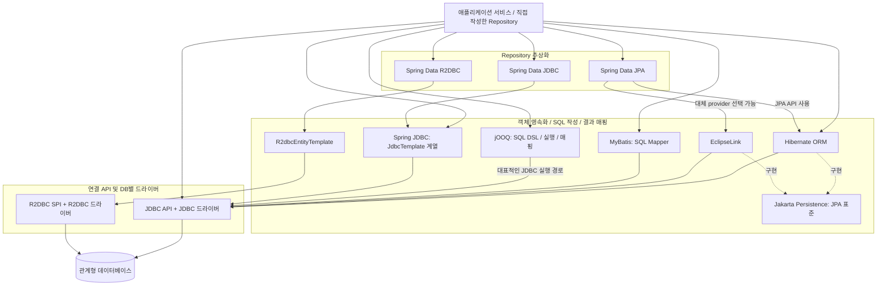
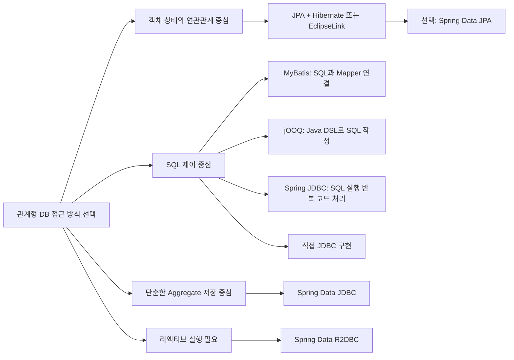
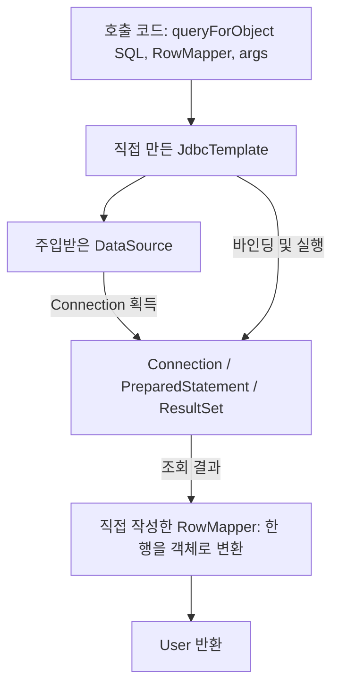

# Java ORM과 데이터 접근 생태계

작성일: 2026-10-30

관계형 데이터베이스를 사용하는 Java 기술을 대상으로 정리한다. 아래 계층은 역할을 이해하기 위한 구분이며, 모든 라이브러리가 정확히 한 계층에만 속하지는 않는다.

## 1. 전체 계층

실선은 대표적인 호출·사용 경로다. 점선은 표준 구현 관계이며, 실행 중 거치는 별도 프로세스를 뜻하지 않는다. 같은 상자 안에 나란히 있다고 해서 설정만 바꿔 교체할 수 있는 것은 아니다.

JPA는 객체 영속화와 객체·관계 매핑을 정의하는 **표준 명세**다. Hibernate와 EclipseLink는 이를 구현하는 provider다. JPA API 의존성만 추가해서는 실제 DB 작업을 수행할 수 없다. [Jakarta Persistence 공식 설명](https://jakarta.ee/specifications/persistence/), [공식 프로젝트의 구현체 안내](https://github.com/jakartaee/persistence)

Spring Data JPA는 JPA 기반 Repository 구현을 지원한다. 따라서 Spring Data JPA와 Hibernate는 서로 다른 역할을 맡으며 함께 사용할 수 있다. Spring Data JPA를 쓰지 않고 JPA의 `EntityManager`를 직접 사용하는 것도 가능하다. [Spring Data JPA](https://docs.spring.io/spring-data/jpa/reference/)

## 2. 계층별 대안과 교체 범위

| 계층 / 역할 | 비교할 대안 | 교체할 때 바뀌는 부분 |
|---|---|---|
| Repository 자동화 | Spring Data JPA / Spring Data JDBC / Spring Data R2DBC / 직접 작성 | 저장·조회 구현과 객체 매핑 방식. 인터페이스가 비슷해도 의미와 설정이 다름 |
| JPA provider | Hibernate ORM / EclipseLink | provider 의존성·설정. 표준 API 밖의 확장 기능과 SQL 동작도 확인 필요 |
| SQL 중심 데이터 접근 | MyBatis / jOOQ / Spring JDBC / 직접 작성한 JDBC 코드 | SQL 표현 방식, 파라미터 바인딩, 결과 매핑 코드 |
| Spring JDBC 호출 API | JdbcTemplate / NamedParameterJdbcTemplate / JdbcClient | 위치 기반·이름 기반 파라미터와 호출 스타일 |
| 연결 프로그래밍 모델 | JDBC / R2DBC | 블로킹·리액티브 API, 반환 타입, 트랜잭션과 실행 흐름 |
| JDBC 드라이버 | H2 / PostgreSQL / MySQL 등의 드라이버 | 연결 대상과 URL. DB를 바꾸면 SQL 방언·스키마도 검증 필요 |

여기서 **대체 가능**은 같은 요구를 다른 방식으로 구현할 수 있다는 뜻이다. 코드 수정 없이 호환된다는 뜻은 아니다.

이 분류는 선택 기준을 정리한 것이며, 한 애플리케이션에서 여러 방식을 조합할 수도 있다.

## 3. SQL과 객체를 누가 관리하는가

| 기술 | SQL 작성 | 결과 매핑 | 조회한 객체의 변경 반영 |
|---|---|---|---|
| 직접 JDBC | 개발자 | 개발자 | UPDATE 직접 실행 |
| Spring JDBC | 개발자 | RowMapper 또는 제공 매퍼 | UPDATE 명시 호출 |
| MyBatis | 개발자: XML·애너테이션 등 | 설정·규칙에 따라 프레임워크가 처리 | UPDATE Mapper 명시 호출 |
| jOOQ | 개발자: SQL DSL 등 | Record 및 객체 매핑 API | 명시적인 DML·저장 호출 |
| Spring Data JDBC | 기본 CRUD SQL 생성, 직접 쿼리도 가능 | Aggregate 중심 매핑 | save 등 명시 호출 |
| JPA provider | 객체 매핑 기반 생성, 직접 쿼리도 가능 | 엔티티 매핑 | 관리 상태의 엔티티 변경을 flush 시 반영 가능 |

MyBatis는 직접 작성한 SQL과 Java 객체의 매핑을 지원한다. jOOQ는 SQL을 Java DSL로 표현하는 기능을 중심으로 실행과 매핑도 제공한다. 두 기술을 JPA provider와 같은 종류로 묶으면 역할을 혼동하기 쉽다. [MyBatis 소개](https://mybatis.org/mybatis-3/index.html), [jOOQ SQL DSL](https://www.jooq.org/doc/latest/manual/sql-building/)

Spring JDBC는 JDBC 실행과 자원 관리의 반복 작업을 줄여준다. `JdbcClient`는 흔한 조회·수정 작업을 위한 fluent API이며 내부적으로 템플릿에 위임한다. 배치 등 세부 기능은 `JdbcTemplate` 계열을 직접 사용할 수 있다. [Spring JDBC 공식 문서](https://docs.spring.io/spring-framework/reference/data-access/jdbc/core.html)

Spring Data JDBC는 JPA와 달리 영속성 세션과 엔티티 프록시를 전제로 하지 않는다. 일반적인 JPA 변경 감지나 지연 로딩을 기대해서는 안 된다. JPA에서도 모든 객체 수정이 자동 저장되는 것은 아니며, 관리 상태·트랜잭션·flush 조건을 함께 이해해야 한다. [Spring Data JDBC 설계 설명](https://staging.spring.io/blog/2018/09/17/introducing-spring-data-jdbc/), [Jakarta Persistence 명세](https://jakarta.ee/specifications/persistence/)

## 4. 함께 사용하는 기술

- **Spring Data JPA + Hibernate**: Repository 자동화와 JPA 영속화 구현을 결합한다.
- **Spring JDBC + JDBC 드라이버**: 템플릿이 JDBC 호출을 정리하고 드라이버가 DB 통신을 담당한다.
- **JPA + SQL 중심 조회 기술**: 예를 들어 엔티티 저장은 JPA로, 복잡한 조회는 jOOQ나 MyBatis로 구현할 수 있다. 같은 DB를 사용해도 Connection·트랜잭션 공유를 설정해야 하며, JPA flush 시점과 캐시의 일관성을 확인해야 한다.
- **커넥션 풀 + JDBC 접근 기술**: 풀은 연결을 재사용하는 역할이다. ORM이나 SQL Mapper의 대체재가 아니다.
- **트랜잭션 관리 + 각 접근 기술**: commit·rollback 범위를 다루는 별도 관심사다. `@Transactional`만 붙인다고 모든 연결이 자동으로 같은 트랜잭션에 참여하는 것은 아니다.

R2DBC는 JDBC 드라이버를 교체하는 옵션이 아니라 별도의 연결 API 경로다. Spring Data R2DBC는 이 경로의 Repository·객체 매핑 기능을 제공한다. [Spring Data Relational](https://docs.spring.io/spring-data/relational/reference/), [R2DBC 안내](https://docs.spring.io/spring-data/relational/reference/r2dbc.html)

## 5. simple-jorm의 위치와 학습 순서

현재 목표는 JDBC 위에서 SQL 실행의 반복 코드를 직접 추상화하는 것이다. 아래는 이 프로젝트에 대한 학습 제안이며, 앞부분만 구현해도 독립적인 학습 결과가 된다.

| 순서 | 직접 만들 기능 | 배울 내용 |
|---|---|---|
| 1 | JdbcTemplate + RowMapper | 자원 정리, 콜백, 파라미터 바인딩, 단건 조회 결과 수 검증 |
| 2 | 리플렉션 자동 매핑 | 컬럼과 필드 연결, 타입 변환, 메타데이터 |
| 3 | @Select + Mapper 프록시 | 메서드 호출을 SQL 실행으로 연결 |
| 4 | 트랜잭션 관리자 | 여러 작업의 Connection 공유, commit·rollback, 자원 반환 |
| 5 | 엔티티 기반 CRUD | 테이블·ID 매핑과 SQL 생성 |
| 6 | 영속성 컨텍스트와 변경 감지 | 객체 동일성, 스냅샷, flush |

현재 `JdbcTemplate`과 `RowMapper` 단계는 SQL 실행·매핑 추상화에 해당한다. 이후 엔티티 메타데이터와 SQL 생성, 상태 관리 등을 추가하면서 ORM의 구조를 학습할 수 있다.

## 6. 의존성 관리 관점

현재 프로젝트는 Java 21과 Gradle Wrapper 8.9를 사용한다.

- JDBC API는 JDK의 `java.sql` 모듈에 포함된다. `javax.sql.DataSource`도 JDK에서 제공한다.
- DB별 JDBC 드라이버는 별도 의존성이다. 현재 H2 `2.4.240`은 테스트 의존성으로 등록되어 있다.
- `simple-jorm` 본체는 JDBC API에 의존하고, 호출 애플리케이션이나 테스트가 DataSource와 드라이버를 준비하도록 구성한다.
- Hibernate·MyBatis·Spring JDBC 등의 내부 구조를 직접 공부하는 현재 단계에서는 이 라이브러리들을 본체 의존성으로 추가할 필요가 없다.

[Java 21 java.sql 모듈 문서](https://docs.oracle.com/en/java/javase/21/docs/api/java.sql/module-summary.html)
