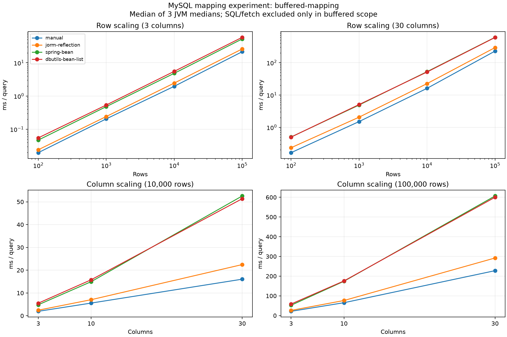
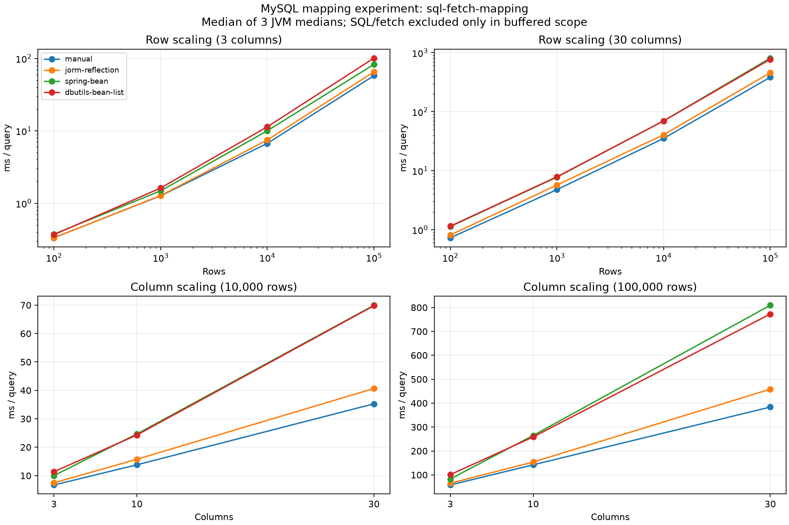

# 행 수·필드 수에 따른 JDBC 매핑 비용 실험

실험일: 2026-10-30, Asia/Seoul. 학습용 로컬 실험이며 JMH 결과나 운영 환경의 처리량 측정은 아니다.

## 질문과 실험군

행 수와 필드 수가 증가할 때 수동 매핑과 리플렉션 기반 자동 매핑의 차이는 어떻게 변하는가? SQL 실행·결과 전송까지 포함하면 그 비율은 어떻게 달라지는가?

| 식별자 | 실험군 | 객체 생성·대입 | 실험 시 재사용하는 정보 |
|---|---|---|---|
| `manual` | 직접 작성한 JDBC 매퍼 | `new`와 명시적 setter 호출, 컬럼명으로 JDBC getter 호출 | 컴파일된 코드 |
| `jorm-reflection` | 현재 simple-jorm `BeanPropertyRowMapper` | 기본 생성자와 `Field.set()` | 생성자·필드 Map은 매퍼 생성 때 검색. 컬럼 라벨·필드 연결은 행마다 처리 |
| `spring-bean` | Spring JDBC 6.2.12 `BeanPropertyRowMapper` | JavaBean 프로퍼티를 통한 자동 매핑 | 재사용하는 매퍼의 프로퍼티 메타데이터 |
| `dbutils-bean-list` | Apache Commons DbUtils 1.8.1 `BeanProcessor.toBeanList()` | JavaBean 자동 매핑 | 컬럼과 프로퍼티 연결을 결과 집합마다 계산하고 행들에 재사용 |

실제 라이브러리의 매핑 컴포넌트를 같은 JDBC 실행 경로에 연결했다. Spring `JdbcTemplate`, DbUtils `QueryRunner` 전체 파이프라인을 비교한 것은 아니다. 수동 기준군은 Spring의 사용자 `RowMapper`, DbUtils의 사용자 `ResultSetHandler`에서 작성하는 것과 같은 명시적 객체 생성 방식이다. 이 인터페이스들의 프레임워크 오버헤드는 별도로 측정하지 않았다.

## 환경

| 항목 | 값 |
|---|---|
| CPU | Intel Core i7-11700 @ 2.50GHz, 물리 8코어 / 논리 16개 |
| RAM | 34,065,707,008 bytes, 약 31.7 GiB |
| OS | Windows 11 Enterprise, 10.0.26200, amd64 |
| JVM | Azul OpenJDK 21.0.11+10-LTS, 64-Bit Server VM |
| JVM heap | `-Xms512m -Xmx512m` |
| 빌드 | Gradle Wrapper 8.9, Java toolchain 21 |
| DB | MySQL 8.0.37, 같은 호스트의 TCP localhost:3306, Win64/x86_64 |
| JDBC 드라이버 | MySQL Connector/J 9.7.0 |
| DB 설정 | InnoDB buffer pool 128 MiB, utf8mb4 / utf8mb4_0900_ai_ci, max_connections 151 |
| 연결 | 기존 단일 연결 재사용, 커넥션 풀 없음, 조회 시 autoCommit=true |
| JDBC URL 설정 | `rewriteBatchedStatements=true` — 데이터 준비용 배치 최적화 |
| DB 공간 | `simple_jorm_mapping_benchmark`; 폭별 세션 전용 임시 테이블 |

프로세스별 실제 JVM 인자, DB 버전·설정과 UTC 시작 시각은 [환경 원본](results/2026-10-30-scaling-v2/environment-fork-1.txt)에 있다. 계정·비밀번호는 기록하지 않았다. 전용 머신으로 격리하지 않았으므로 다른 프로세스의 간섭을 배제하지 못한다.

## 실험 설계

- 행 수: **100 / 1,000 / 10,000 / 100,000**.
- 필드 수: **3 / 10 / 30**. 모든 조합 12개를 측정한다. 동일한 폭에서 행 수만 비교하고, 동일한 행 수에서 폭만 비교할 수 있다.
- 각 폭에 정확히 맞는 JavaBean과 테이블을 사용한다. 전체 필드 수에는 `BIGINT id` 1개가 포함되고, 나머지는 `VARCHAR(40)` ↔ `String`이다.
- 문자열 값은 `v{행}_{컬럼}`, `(행+컬럼)%17==0`이면 SQL NULL이다. 30필드 빈에 일부 컬럼만 채우는 방식이 아니다.
- 모든 군은 동일 SQL, 동일 결과 순서 `ORDER BY id`, 같은 클래스, 같은 데이터·필드 수를 사용한다. 수동 매퍼도 컬럼명을 사용해 이름 조회 비용을 부담한다.
- 각 조건에서 네 매퍼가 **모든 행의 모든 필드와 NULL을 정확히 반환하는지** 측정 전에 검증한다. 값 검증은 측정 시간에서 제외한다.
- 독립 JVM **3개**, 조건별 워밍업 **2라운드**, 측정 **5라운드**. 라운드마다 군 순서를 섞는다. 시드는 환경 파일에 기록한다. 폭 순서는 3→10→30, 행 수 순서는 증가 순서다.
- 표본당 조회 반복 수는 `max(1, 20,000 / 행 수)`: 각각 **200 / 20 / 2 / 1회**. 표본의 총 시간을 반복 수로 나눠 1회 조회 시간으로 환산한다.
- 매퍼 생성은 시간에서 제외한다. 결과 리스트는 volatile sink에 전달해 객체 생성이 제거되지 않도록 한다. 표본 시작 전에 이전 sink를 비우며 강제 GC는 호출하지 않는다.
- 표본별 `gc_count`, `gc_ms`는 JVM GC 카운터의 차이다. 동시 GC가 있으므로 전체 조회 시간에서 단순 차감하지 않는다.
- 대표값은 각 JVM의 표본 5개 중앙값을 구한 뒤, JVM 중앙값 3개의 중앙값이다. 원시 표본 1,440개와 JVM별 중앙값을 보관한다.

| 측정 범위 | 포함 | 제외 |
|---|---|---|
| `buffered-mapping` | 이미 읽어둔 MySQL ResultSet의 커서 재설정·순회, JDBC 값 읽기, 리스트·객체 생성, 매핑, 해당 구간의 GC 영향 | SQL 실행, 최초 결과 전송·버퍼링, 연결 획득, 매퍼 생성 |
| `sql-fetch-mapping` | statement 준비, SELECT 실행, 결과 전송·드라이버 버퍼링, 순회·매핑·리스트 생성, ResultSet/statement 닫기, 해당 구간의 GC 영향 | 연결 획득, 스키마·데이터 준비, 매퍼 생성 |

기본 드라이버의 버퍼링 방식을 사용한다. 서버 커서·스트리밍, 네트워크 지연 주입, 동시 요청은 다루지 않는다. `sql-fetch-mapping` 측정 중에는 매핑 단독 실험용 ResultSet을 추가로 보유하지 않는다.

## 결과

대표 결과는 다음과 같다. 단위는 **ms/조회**, SQL·결과 전송·매핑을 포함하고 연결 생성은 제외한다.

| 행 수 | 필드 수 | 수동 | jorm 자동 | Spring 자동 | DbUtils 자동 |
|---:|---:|---:|---:|---:|---:|
| 10,000 | 3 | 6.711 | 7.463 | 10.016 | 11.372 |
| 10,000 | 30 | 35.272 | 40.664 | 69.944 | 69.794 |
| 100,000 | 3 | 57.836 | 65.194 | 82.832 | 101.037 |
| 100,000 | 30 | 383.606 | 458.303 | 809.088 | 772.589 |

**필드 수 증가:** 10,000행에서 3→30필드로 늘리면 현재 자동 매퍼의 수동 대비 차이는 약 0.75ms에서 5.39ms로 커진다. 100,000행에서는 약 7.36ms에서 74.70ms로 커진다. 필드 수가 10배가 되는 동안 문자열 필드는 2→29개로 늘고 전송량도 달라지므로, 시간을 필드 수에 단순 정비례한다고 가정하지 않는다.

**행 수 증가:** 30필드에서 10,000→100,000행으로 늘리면 수동은 35.27→383.61ms, 현재 자동 매퍼는 40.66→458.30ms다. 비율은 약 1.15→1.19배로 변하고, 절대 차이는 5.39→74.70ms다. 행이 많아져도 배율이 무조건 폭증하는 것은 아니지만 누적 비용은 커진다.

**매핑 단독과 전체 조회:** 100,000행·30필드의 이미 버퍼링된 매핑은 수동 227.69ms / jorm 292.12ms / Spring 606.75ms / DbUtils 600.22ms다. SQL 포함 시 jorm은 수동의 약 1.19배, Spring은 2.11배, DbUtils는 2.01배다. “DB 작업을 포함하면 자동 매핑 차이는 항상 작다”로 일반화할 수 없다. 기능이 풍부한 자동 매퍼와 대량 결과에서는 전체 조회에서도 차이가 커질 수 있다.

Spring과 DbUtils 수치가 현재 자동 매퍼보다 큰 것은 이 조건의 측정 결과다. 타입 변환과 프로퍼티 처리 등 기능이 다르므로 현재 구현이 일반적으로 더 우수하다는 결론은 내리지 않는다. JVM별 변동 폭과 GC는 전체 표에 함께 제시한다.

- [전체 24조건 결과, JVM별 중앙값·GC](results/2026-10-30-scaling-v2/tables.md)
- [집계 CSV](results/2026-10-30-scaling-v2/summary.csv)
- 원시 표본: [JVM 1](results/2026-10-30-scaling-v2/scaling-fork-1.csv), [JVM 2](results/2026-10-30-scaling-v2/scaling-fork-2.csv), [JVM 3](results/2026-10-30-scaling-v2/scaling-fork-3.csv)





## Java 라이브러리의 매핑 방식 비교

### 실제 조회 API를 사용하는 추가 실험

위 12개 조합의 컴포넌트 비교 외에 **10,000행 × 30필드**에서 실제 라이브러리 조회 API도 짝지어 비교했다.

- Spring `JdbcTemplate.query(sql, 사용자 RowMapper)`와 `query(sql, BeanPropertyRowMapper)`.
- DbUtils `QueryRunner.query(connection, sql, 사용자 ResultSetHandler)`와 `query(connection, sql, BeanListHandler)`.
- 동일 데이터·JavaBean·수동 매퍼, 기존 물리 연결 재사용. Spring은 `SingleConnectionDataSource(connection, true)`로 close를 억제하고 DbUtils는 동일 연결을 인자로 받는다. 연결 접근·예외 변환·리스트 처리 등 프레임워크 차이도 포함되므로 **같은 라이브러리 안의 수동/자동 비교**를 우선 해석한다.
- 독립 JVM 3개, JVM당 워밍업 2라운드와 측정 5라운드, 표본당 2회 조회. 군 순서를 시드 `20261030+fork`로 섞었다. 측정 전에 모든 필드의 결과를 검증한다. 추가 원시 표본은 총 60개다. 주 실험과 동일한 JVM·DB 설정을 사용했다.
- [조회 API 비교 결과 및 JVM별 중앙값](results/2026-10-30-scaling-v2/library-tables.md), 원시 CSV: [JVM 1](results/2026-10-30-scaling-v2/library-fork-1.csv), [JVM 2](results/2026-10-30-scaling-v2/library-fork-2.csv), [JVM 3](results/2026-10-30-scaling-v2/library-fork-3.csv).
- 코드: [LibraryMappingBenchmark.java](../../src/test/java/com/jorm/jdbc/lab/LibraryMappingBenchmark.java).

| 조회 API | 수동 매퍼 ms | 자동 매퍼 ms | 자동/수동 |
|---|---:|---:|---:|
| Spring JdbcTemplate | 37.013 | 67.524 | 1.82배 |
| DbUtils QueryRunner | 35.570 | 70.108 | 1.97배 |

같은 라이브러리에서 SQL 실행 경로를 유지하고 매퍼만 바꾸어도 차이가 관측됐다. 반면 서로 다른 라이브러리의 수동 매퍼 35.57ms와 37.01ms 정도의 차이는 이 표본만으로 성능 우열을 주장할 근거가 되지 않는다.

라이브러리를 통째로 “리플렉션 진영”과 “수동 진영”으로 분리하기는 어렵다. 같은 라이브러리에서도 자동 매퍼와 사용자 콜백을 선택할 수 있다. 아래에서 **실측**과 **문헌 비교**를 구분한다.

| 라이브러리 | 자동 매핑 경로 | 수동 매핑 경로 | 이번 범위 |
|---|---|---|---|
| Spring JDBC | `BeanPropertyRowMapper`: 컬럼명과 JavaBean setter 연결 | 사용자 `RowMapper<T>`에 직접 생성·대입 | 자동 매퍼 12조건 실측 + 조회 API 수동/자동 추가 실측 |
| Apache Commons DbUtils | `BeanProcessor` / `BeanListHandler`: BeanInfo와 리플렉션 활용 | 사용자 `ResultSetHandler<T>` | 자동 매퍼 12조건 실측 + QueryRunner 수동/자동 추가 실측 |
| Jdbi | `BeanMapper`, `FieldMapper`, `ConstructorMapper` | 사용자 `RowMapper`, `.map((rs, ctx) -> ...)` | 공식 문서 비교만 수행; 수치 없음 |
| jOOQ | `DefaultRecordMapper`를 사용하는 `into(Class)` 등 | 사용자 `RecordMapper`, 명시적 생성자/람다 | 공식 문서 비교만 수행; 수치 없음 |
| MyBatis | 자동 매핑 또는 명시적 `resultMap`에 따라 객체 프로퍼티 매핑 | XML에 SQL·컬럼 연결을 명시하는 것과 Java 코드로 직접 대입하는 것은 별개 | 공식 문서·소스 비교만 수행; 수치 없음 |

Spring의 공식 Javadoc은 자동 Bean 매퍼의 편의성을 설명하며 성능이 중요한 경우 사용자 RowMapper를 고려하도록 안내한다. 따라서 Spring 사용 자체가 리플렉션 매핑을 강제하는 것은 아니다. [BeanPropertyRowMapper 6.2.12](https://docs.spring.io/spring-framework/docs/6.2.12/javadoc-api/org/springframework/jdbc/core/BeanPropertyRowMapper.html), [사용자 RowMapper](https://docs.spring.io/spring-framework/docs/6.2.12/javadoc-api/org/springframework/jdbc/core/RowMapper.html)

DbUtils의 `toBeanList`는 `toBean`을 매 행 호출하는 루프와 다르다. 공개 소스에서 목록 전체에 대한 컬럼·프로퍼티 연결을 먼저 만들고 각 행에 재사용한다. 이 실험도 목록 API를 사용했다. [BeanProcessor 소스](https://commons.apache.org/proper/commons-dbutils/jacoco/org.apache.commons.dbutils/BeanProcessor.java.html), [ResultSetHandler API](https://commons.apache.org/proper/commons-dbutils/apidocs/org/apache/commons/dbutils/ResultSetHandler.html)

Jdbi는 수동 RowMapper와 리플렉션 매퍼를 모두 제공한다. `FieldMapper.specialize`는 결과 집합에 특화된 매퍼로 컬럼 연결을 반복하지 않는 최적화도 지원한다. 그러므로 현재 simple-jorm 결과를 Jdbi의 성능으로 대입할 수 없다. [Jdbi 3.55 가이드](https://jdbi.org/releases/3.55.0/), [FieldMapper API](https://jdbi.org/releases/3.55.0/apidocs/org/jdbi/v3/core/mapper/reflect/FieldMapper.html)

jOOQ도 기본 POJO 매핑과 사용자 RecordMapper가 공존한다. 스키마의 Java 코드를 생성했다는 사실만으로 모든 POJO 매핑 경로가 리플렉션을 사용하지 않는다고 단정할 수 없다. [DefaultRecordMapper](https://www.jooq.org/javadoc/latest/org.jooq/org/jooq/impl/DefaultRecordMapper.html), [사용자 RecordMapper](https://www.jooq.org/doc/latest/manual/sql-execution/fetching/recordmapper/)

MyBatis는 SQL을 직접 작성하는 SQL Mapper이지만, 그것이 객체 생성·프로퍼티 대입까지 직접 컴파일된 Java 코드라는 뜻은 아니다. `resultMap`의 명시성과 런타임 대입 구현을 구분해야 한다. 공식 `MethodInvoker` 소스의 메서드 호출 경로도 리플렉션을 이용한다. [Result Maps와 Auto-mapping](https://mybatis.org/mybatis-3/sqlmap-xml.html), [MyBatis 3.5.19 MethodInvoker 소스](https://github.com/mybatis/mybatis-3/blob/mybatis-3.5.19/src/main/java/org/apache/ibatis/reflection/invoker/MethodInvoker.java)

## 해석의 한계

- 자동 매퍼의 타입 변환·프로퍼티 규칙·오류 처리 기능이 서로 다르다. 시간 차이는 `Field.set` 대 직접 setter 호출의 차이만이 아니다. 현재 simple-jorm은 지원 범위가 훨씬 좁다.
- 캐시된 DB·JVM을 사용하는 정상 상태 위주의 측정이다. 프로세스 최초 시작, 연결 인증 비용, 콜드 디스크 읽기, 지연 로딩·변경 감지·연관 객체 매핑은 포함하지 않았다.
- 100,000행 × 30필드는 객체 할당과 드라이버 버퍼가 커지고 GC가 개입한다. 시간이 행 수에 정확히 비례하지 않거나 군 순위가 흔들려도 리플렉션 하나로 원인을 단정하지 않는다.
- 이미 버퍼링된 결과의 매핑도 JDBC getter와 컬럼 조회를 포함한다. 앞선 H2 단독 실험과 드라이버·데이터·객체 구조가 다르므로 배율을 그대로 연결하지 않는다.
- 작은 표본, 제한된 워밍업, 로컬 단일 DB, 병렬 요청 없음. 작은 비율 차이에 통계적 유의성을 주장하지 않는다. 라이브러리 전체의 우열이나 운영 서비스 응답시간으로 일반화하지 않는다.
- 예비 실행은 전체 조회 측정 때 불필요한 버퍼를 유지한 문제가 있어 폐기했다. [폐기 데이터 설명](results/README.md). 최종 표와 그래프에는 v2만 사용한다.

## 재현

프로젝트 루트에서 실행한다. MySQL에 `simple_jorm_mapping_benchmark` DB가 있어야 하고, 계정에 해당 DB의 임시 테이블 생성 권한이 필요하다. 비밀번호는 환경변수로만 전달한다.

```powershell
$env:JORM_DB_URL = 'jdbc:mysql://localhost:3306/?rewriteBatchedStatements=true'
$env:JORM_DB_USER = '<사용자명>'
# JORM_DB_PASSWORD 환경변수에 본인의 비밀번호를 설정한다.
.\doc\lab\run-mapping-scaling.ps1
```

스크립트는 주 실험용 JVM 3개와 조회 API 실험용 JVM 3개를 순차 실행하고 새 시각별 결과 폴더에 CSV·환경 파일·표·그래프를 생성한다. 집계와 그래프에는 Python과 matplotlib가 필요하다. Java 실험 자체에는 Python이 필요하지 않다.

```powershell
# 기존 원시 데이터의 표와 그림만 재생성
python doc/lab/summarize_mapping_scaling.py doc/lab/results/2026-10-30-scaling-v2
# 기존 동작 검증
.\gradlew.bat test
```

실험 코드는 [MappingScalingBenchmark.java](../../src/test/java/com/jorm/jdbc/lab/MappingScalingBenchmark.java), 고정 크기 빈과 명시적 매퍼는 [ScalingRows.java](../../src/test/java/com/jorm/jdbc/lab/ScalingRows.java)에 있다. 비교 라이브러리는 테스트 의존성에만 추가했으며 simple-jorm 본체의 의존성은 바뀌지 않는다.
